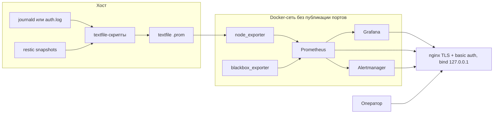
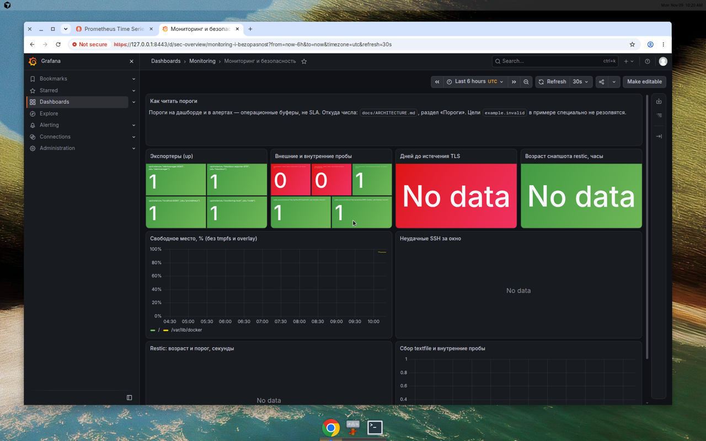
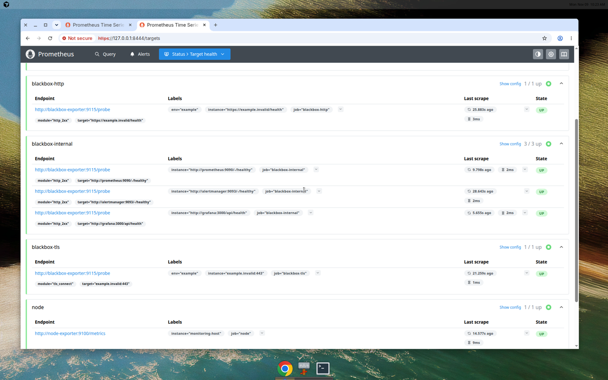
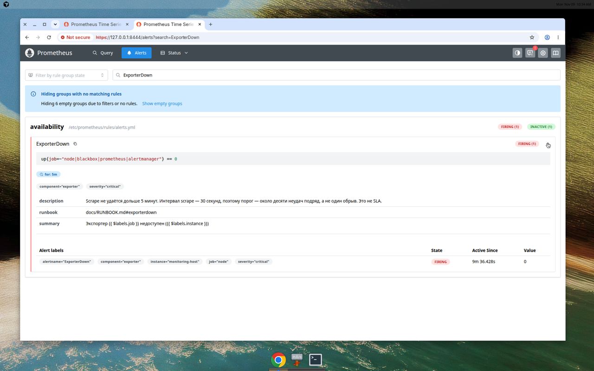
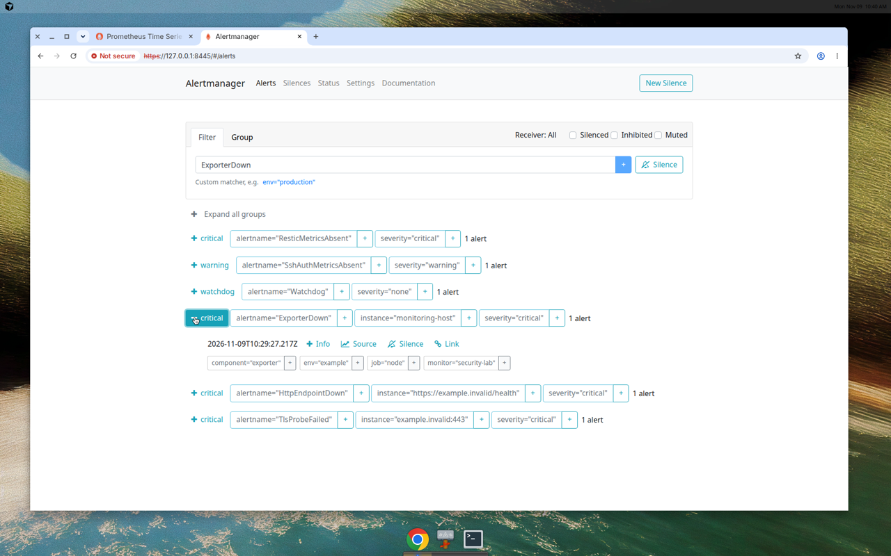

# Мониторинг и алертинг с упором на безопасность

Тестовое по форме: не только стенд, но и почему он собран так, где пороги взяты и чего стенд не обещает. Стек для sysadmin/DevOps, который переходит в информационную безопасность: видеть падение хоста и экспортёров, место на диске, чужой HTTP, срок TLS, возраст снапшота restic и всплеск неудачных SSH.

Рядом по смыслу репозиторий [test-task-sys-admin-infr-engineer](https://github.com/aidarshakirovr/test-task-sys-admin-infr-engineer): там restic с RPO 4 часа и разбор, почему UFW не видит порты Docker. Отсюда алерт на возраст того же снапшота и DROP в `DOCKER-USER`, которого в том `after.rules` нет.

Секретов, боевых адресов и доменов в git нет. Цели проб — `example.invalid`. Пароли — Ansible Vault или файлы в `docker/secrets/`, каталог в `.gitignore`.

## Схема



Prometheus, Alertmanager, Grafana и экспортёры наружу не публикуются. На хост смотрит только nginx, по умолчанию на `127.0.0.1`. Подробности и таблица порогов — в [docs/ARCHITECTURE.md](docs/ARCHITECTURE.md). Пороги — не SLA.

## Быстрый старт

Локально, без Ansible. Нужны Docker и openssl. Стек качает образы и поднимает контейнеры; этот репозиторий сам по себе CI-проверками контейнеры не стартует.

```bash
bash scripts/bootstrap-local-secrets.sh
docker compose --env-file docker/secrets/compose.env -f docker/compose.yaml up -d
```

Пароли лежат в `docker/secrets/`, скрипт их не печатает. Пользователь nginx basic auth — `monitoring`. Пользователь Grafana — `admin`. UI:

- Grafana: `https://127.0.0.1:8443` (сертификат `monitoring.example`, самоподписный)
- Prometheus: `https://127.0.0.1:8444`
- Alertmanager: `https://127.0.0.1:8445`

Пока цели не заменены, алерты `HttpEndpointDown` и `TlsProbeFailed` на `example.invalid` будут гореть. Так и задумано.

Ansible, на хосте где уже есть Docker (роль его не ставит и не качает скриптом):

```bash
cp ansible/group_vars/all/vault.yml.example ansible/group_vars/all/vault.yml
ansible-vault encrypt ansible/group_vars/all/vault.yml
ansible-galaxy collection install -r ansible/requirements.yml
ansible-playbook -i ansible/inventories/staging/hosts.ini ansible/site.yml --syntax-check
# боевой прогон — отдельное решение, inventory production тоже с заглушками:
# ansible-playbook -i ansible/inventories/production/hosts.ini ansible/site.yml
```

Строки `REPLACE_ME` из примера Vault роль не подставляет: пароль будет сгенерирован на хосте в `/opt/monitoring-stack/docker/secrets/`.

Проверки без деплоя:

```bash
bash scripts/ci-local.sh
```

## Структура

| Путь | Зачем |
| --- | --- |
| `docker/compose.yaml` | Prometheus, Alertmanager, Grafana, node_exporter, blackbox_exporter, nginx |
| `monitoring/prometheus/rules/alerts.yml` | Правила. Имена алертов на английском, текст на русском |
| `monitoring/prometheus/tests/alerts_test.yml` | `promtool test rules` |
| `monitoring/grafana/` | Datasource и дашборд |
| `scripts/restic-textfile.sh` | Возраст снапшота restic → textfile |
| `scripts/ssh-auth-metrics.sh` | Неудачные SSH за окно → textfile |
| `scripts/monitoring-docker-user.sh` | DROP портов прокси в `DOCKER-USER` |
| `ansible/` | Роли `monitoring_textfile`, `monitoring_stack`, `monitoring_firewall`, inventory-примеры |
| `docs/ARCHITECTURE.md` | Решения и пороги |
| `docs/RUNBOOK.md` | Что значит алерт, как проверить, как не навредить |
| `docs/RISKS.md` | Ограничения |
| `docs/VERIFICATION.md` | Что реально прогнано |
| `.github/workflows/validate.yml` | CI: `contents: read`, action по SHA |

Образы закреплены тегом и digest: Prometheus `v3.16.0`, Alertmanager `v0.34.2`, Grafana `13.3.0`, node_exporter `v1.12.1`, blackbox_exporter `v0.29.1`, nginx-unprivileged `1.29.8-alpine`. Digest снят с манифеста, который скачала эта среда; на другой архитектуре его нужно сверить.

## Проверено вживую

Дата: 2026-11-09, эта ВМ. Это не прод. Пароли создал `scripts/bootstrap-local-secrets.sh`. Каталог `docker/secrets/` в git не входит.

Стек поднят так:

```bash
bash scripts/bootstrap-local-secrets.sh
docker compose --env-file docker/secrets/compose.env -f docker/compose.yaml up -d
```

На самой ВМ `ansible-playbook -i ansible/inventories/staging/hosts.ini ansible/site.yml` останавливается: PID 1 — tini, не systemd. Роль `monitoring_textfile` прогнана в привилегированном контейнере `ubuntu:24.04` с systemd как PID 1 (`--privileged`, `--cgroupns=host`). `ansible-playbook --tags textfile` завершился без ошибок. Таймеры `ssh-auth-metrics.timer` и `restic-textfile.timer` в состоянии `enabled`. Роли `monitoring_stack` и `monitoring_firewall` в контейнере не применялись.

`node_exporter` сначала не стартовал: `/` был `private`, bind `rslave` из compose демону не подошёл. На ВМ выполнен `mount --make-rshared /`. В репозиторий это не входит. После этого контейнеры healthy. С хоста слушают только `127.0.0.1:8443`, `:8444`, `:8445`. Без пароля Grafana, Prometheus и Alertmanager отвечают 401, `/healthz` — 200. `http://127.0.0.1:9090` с хоста не открывается.

Между контейнерами трафик сначала не ходил. У `iptables-legacy` политика FORWARD была DROP и цепочки знали только `docker0`, а Docker 29 пишет правила в iptables-nft. Чтобы scrape заработал, на ВМ выставлено `iptables-legacy -P FORWARD ACCEPT`. Этого нет в репозитории, и это не доказательство DROP в `DOCKER-USER`.

До остановки `node_exporter` API Prometheus показал 9 активных target, все `up`: prometheus, alertmanager, node, blackbox, blackbox-http, blackbox-internal (три health) и blackbox-tls. Групп правил 7, правил 25, у всех `health=ok`. Alertmanager `0.34.2`, `/-/ready` ответил 200, cluster disabled. `probe_success` равен 1 для `http://grafana:3000/api/health`, `http://prometheus:9090/-/healthy` и `http://alertmanager:9093/-/healthy`. Для `https://example.invalid/health` и `example.invalid:443` он равен 0. `HttpEndpointDown` и `TlsProbeFailed` дошли до FIRING. Для этих целей так и задумано.

Grafana открывается, дашборд «Мониторинг и безопасность» рисует панели. На `main` они были «Error loading»: общий `limit_req` (10 r/s, burst 40) отдавал 503 на `/public/build/*.js`. Статика вынесена в свою зону `assets`, не общую с `auth`: `rate=10r/s`, `burst=200`. `limit_req` срабатывает до `auth_basic`. Зоны `auth` и `assets` считаются независимо, поэтому суммарно до 20 r/s с одного IP. У `/public/` burst 200, у логина и API burst 40. Проверка: 320 запросов на `/public/x` с неверным паролем дали 204 ответа 401 и 116 ответов 503. После паузы, пока burst снова набрался, страница логина и модули text, stat и timeseries ответили 200. Повторная загрузка дашборда в браузере показала числа, график или «No data», без «Error loading». «No data» на первом снимке были у срока TLS, возраста restic и неудачных SSH: этих рядов тогда не было.

Тестовый алерт: `docker stop monitoring-node-exporter` в 10:24 UTC. `ExporterDown` (job `node`, instance `monitoring-host`) в 10:24 был pending, в 10:29 UTC стал FIRING. Alertmanager принял его со временем `2026-11-09T10:29:27.217Z`. После снимков контейнер снова запущен. До textfile-роли сами горели `ResticMetricsAbsent` и `SshAuthMetricsAbsent`. `Watchdog` горит всегда.

В том же systemd-контейнере поставлен restic, создан локальный репозиторий `/var/backups/restic-repo` и бэкап `/srv/app/data`. `restic-textfile.service` записал `restic_snapshot_check_success=1` и возраст снапшота. Prometheus увидел `restic_snapshot_age_seconds` (63 на момент запроса), и `ResticMetricsAbsent` ушёл из активных алертов. `ResticSnapshotOlderThanRPO` не загорался. sshd в контейнере шесть раз отверг `nosuchuser` с неверным паролем. Скрипт прочитал journald этого контейнера: `ssh_auth_metrics_collection_success=1`, `ssh_auth_failures_last_window=24` (несколько строк журнала на одну попытку). `SshAuthMetricsAbsent` погас. `SshAuthFailuresHigh` стал pending, потому что 24 больше порога 20; 15 минут до FIRING не ждал. journald самой ВМ и restic вне этого контейнера не проверялись.

Пакет внешнего клиента к опубликованному порту при выключенном userland-proxy идёт через DNAT в FORWARD, то есть в `DOCKER-USER`. Это проверено. dockerd запущен с `--userland-proxy=false`, прокси слушал `10.88.0.1`, клиент был в отдельном netns с адресом `10.88.0.2`. Пока allow был только `127.0.0.0/8`, `curl` к `https://10.88.0.1:8443/healthz` оборвался по таймауту, а счётчик DROP с `ctorigdst 10.88.0.1` и `ctorigdstport 8443` в `MONITORING-PROXY-FWD` вырос с 0 до 3. После добавления `10.88.0.0/24` тот же запрос получил 200, счётчик RETURN этого источника стал 10. Счётчики INPUT на этом прогоне остались 0. Затем bind возвращён на `127.0.0.1`, userland-proxy снова включён. На первом прогоне, с docker-proxy и bind `127.0.0.1`, пакеты loopback считались в INPUT (`mon-in-allow` 6, 5 и 4), а `--ctorigdstport` оставался 0. IPv6 по-прежнему без тестовых пакетов. Код скрипта менять не пришлось.









## Документы

- [Архитектура и пороги](docs/ARCHITECTURE.md)
- [Runbook](docs/RUNBOOK.md)
- [Риски](docs/RISKS.md)
- [Проверки](docs/VERIFICATION.md)
