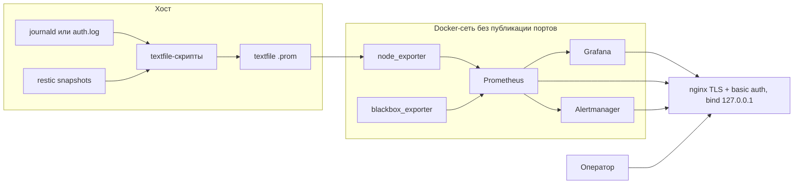

# Мониторинг и алертинг с упором на безопасность

Тестовое по форме: не только стенд, но и почему он собран так, где пороги взяты и чего стенд не обещает. Стек для sysadmin/DevOps, который переходит в информационную безопасность: видеть падение хоста и экспортёров, место на диске, чужой HTTP, срок TLS, возраст снапшота restic и всплеск неудачных SSH.

Рядом по смыслу репозиторий [test-task-sys-admin-infr-engineer](https://github.com/aidarshakirovr/test-task-sys-admin-infr-engineer): там restic с RPO 4 часа и разбор, почему UFW не видит порты Docker. Отсюда алерт на возраст того же снапшота и DROP в `DOCKER-USER`, которого в том `after.rules` нет.

Секретов, боевых адресов и доменов в git нет. Цели проб — `example.invalid`. Пароли — Ansible Vault или файлы в `docker/secrets/`, каталог в `.gitignore`.

## Схема



Prometheus, Alertmanager, Grafana и экспортёры наружу не публикуются. На хост смотрит только nginx, по умолчанию на `127.0.0.1`. Подробности и таблица порогов — в [docs/ARCHITECTURE.md](docs/ARCHITECTURE.md). Пороги — не SLA.

## Быстрый старт

Локально, без Ansible. Нужны Docker и openssl. Стек качает образы и поднимает контейнеры; этот репозиторий сам по себе CI-проверками контейнеры не стартует.

```bash
bash scripts/bootstrap-local-secrets.sh
docker compose --env-file docker/secrets/compose.env -f docker/compose.yaml up -d
```

Пароли лежат в `docker/secrets/`, скрипт их не печатает. Пользователь nginx basic auth — `monitoring`. Пользователь Grafana — `admin`. UI:

- Grafana: `https://127.0.0.1:8443` (сертификат `monitoring.example`, самоподписный)
- Prometheus: `https://127.0.0.1:8444`
- Alertmanager: `https://127.0.0.1:8445`

Пока цели не заменены, алерты `HttpEndpointDown` и `TlsProbeFailed` на `example.invalid` будут гореть. Так и задумано.

Ansible, на хосте где уже есть Docker (роль его не ставит и не качает скриптом):

```bash
cp ansible/group_vars/all/vault.yml.example ansible/group_vars/all/vault.yml
ansible-vault encrypt ansible/group_vars/all/vault.yml
ansible-galaxy collection install -r ansible/requirements.yml
ansible-playbook -i ansible/inventories/staging/hosts.ini ansible/site.yml --syntax-check
# боевой прогон — отдельное решение, inventory production тоже с заглушками:
# ansible-playbook -i ansible/inventories/production/hosts.ini ansible/site.yml
```

Строки `REPLACE_ME` из примера Vault роль не подставляет: пароль будет сгенерирован на хосте в `/opt/monitoring-stack/docker/secrets/`.

Проверки без деплоя:

```bash
bash scripts/ci-local.sh
```

## Структура

| Путь | Зачем |
| --- | --- |
| `docker/compose.yaml` | Prometheus, Alertmanager, Grafana, node_exporter, blackbox_exporter, nginx |
| `monitoring/prometheus/rules/alerts.yml` | Правила. Имена алертов на английском, текст на русском |
| `monitoring/prometheus/tests/alerts_test.yml` | `promtool test rules` |
| `monitoring/grafana/` | Datasource и дашборд |
| `scripts/restic-textfile.sh` | Возраст снапшота restic → textfile |
| `scripts/ssh-auth-metrics.sh` | Неудачные SSH за окно → textfile |
| `scripts/monitoring-docker-user.sh` | DROP портов прокси в `DOCKER-USER` |
| `ansible/` | Роли `monitoring_textfile`, `monitoring_stack`, `monitoring_firewall`, inventory-примеры |
| `docs/ARCHITECTURE.md` | Решения и пороги |
| `docs/RUNBOOK.md` | Что значит алерт, как проверить, как не навредить |
| `docs/RISKS.md` | Ограничения |
| `docs/VERIFICATION.md` | Что реально прогнано |
| `.github/workflows/validate.yml` | CI: `contents: read`, action по SHA |

Образы закреплены тегами: Prometheus `v3.16.0`, Alertmanager `v0.34.2`, Grafana `13.3.0`, node_exporter `v1.12.1`, blackbox_exporter `v0.29.1`, nginx-unprivileged `1.29.8-alpine`. Digest не фиксировался.

## Документы

- [Архитектура и пороги](docs/ARCHITECTURE.md)
- [Runbook](docs/RUNBOOK.md)
- [Риски](docs/RISKS.md)
- [Проверки](docs/VERIFICATION.md)
