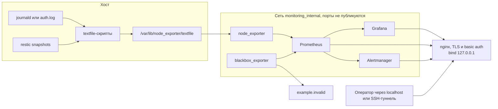

# Архитектура

## Задача и границы

Репозиторий — тестовое по форме: решение, код, почему так, риски и как проверить. Предмет — стек наблюдения для инженера, который из sysadmin/DevOps переходит в информационную безопасность. Стек должен показать, что хост жив, место кончается, внешний HTTP и TLS-сертификат под контролем, бэкап restic не старше заявленного RPO, а всплеск неудачных SSH виден как алерт, а не как «потом посмотрю auth.log».

Это не SOC и не замена auditd/SIEM. Журналы аутентификации здесь не хранятся: в Prometheus попадают счётчики за окно. Расследование по-прежнему идёт в journald.

Связанный репозиторий: [test-task-sys-admin-infr-engineer](https://github.com/aidarshakirovr/test-task-sys-admin-infr-engineer). Оттуда взяты restic, RPO 4 часа и урок про DOCKER-USER. Этот репозиторий бэкап не разворачивает.

## Схема

Prometheus, Alertmanager, Grafana, node_exporter и blackbox_exporter не имеют `ports:` в compose. Единственная публикация — три порта прокси. По умолчанию они привязаны к `127.0.0.1`.

## Почему такой набор

Один compose-файл, который Ansible копирует на хост. Так CI проверяет тот же файл, что пойдёт на сервер (`docker compose config`, `promtool`), а плейбук не собирает YAML заново и не разъезжается с тестами.

Цели blackbox лежат в file_sd. Плейбук перезаписывает только списки целей и `external_labels.env`. Правила алертов остаются файлом из git, который уже прошёл `promtool test rules`.

node_exporter в контейнере, а не пакетом на хосте, потому что задание просит его в том же стеке. Хостовые `/proc`, `/sys` и `/` смонтированы только на чтение, процесс — uid 65534, capabilities сняты. PID namespace хоста не отдаётся: процессов sshd через process-collector не видно, SSH-сигнал идёт из журнала. Это сознательно более узкие права.

blackbox_exporter нужен для двух разных вопросов. `probe_success` — отвечает ли URL. `probe_ssl_earliest_cert_expiry` — когда кончится сертификат. Модуль `http_2xx` не следует редиректам и не ставит `insecure_skip_verify`: иначе алерт зеленеет от чужого 302 или от просроченного сертификата. Отдельный модуль `tls_connect` смотрит рукопожатие даже если HTTP-путь отдаёт не 200.

Внутренние health-check (`/api/health`, `/-/healthy`) идут отдельным job `blackbox-internal`. Падение Grafana не маскируется под «внешний сайт лежит».

Alertmanager в примере не имеет webhook. Пустой receiver — это «алерт принят и никуда не отправлен», а не забытый URL. Боевой адрес подставляется из Vault. Пока его нет, стенд не ходит в интернет с текстом алертов.

Grafana: datasource и один дашборд провиженятся файлами, анонимный вход и регистрация выключены, пароль администратора обязателен и не имеет значения по умолчанию в compose. Пароль из переменной окружения применяется при первом создании базы. Смена файла после этого пароль в UI не меняет; это написано в рисках и в runbook. `GF_PLUGINS_PREINSTALL_DISABLED` выключает фоновую установку плагинов с grafana.com: иначе процесс сам ходит наружу, даже когда аналитика выключена.

## Textfile для restic и SSH

В репозитории backup `restic-rpo-check.sh` сравнивает возраст последнего снапшота с `restic_rpo_hours` (4) и завершается с кодом 1. Здесь `scripts/restic-textfile.sh` пишет тот же возраст в `.prom`:

- `restic_snapshot_age_seconds`
- `restic_rpo_threshold_seconds` — RPO плюс grace
- `restic_snapshot_check_success` — удалось ли измерение, а не «RPO соблюдён»

Код выхода 1 при превышении порога сохранён: `systemctl --failed` красный, даже если Prometheus лежит. При этом `success=1`, потому что измерение удалось. Путаница разобрана в runbook.

Grace по умолчанию 1 час. В том репозитории сравнение строгое с 4 часами, а таймер бэкапа тоже раз в 4 часа. К концу интервала снапшот легитимно почти четырёхчасовой, плюс сам backup данных порядка 100 ГБ ещё может идти. Час запаса этот край закрывает. Он не измерен на стенде. Если `restic backup` стабильно занимает 20 минут, grace стоит уменьшить. Если репозиторий на медленном канале, увеличить. Число живёт в `RPO_GRACE_HOURS` / `monitoring_rpo_grace_hours`.

SSH считается скриптом `scripts/ssh-auth-metrics.sh` в gauge за окно, а не в counter. Textfile перезаписывается целиком, монотонный counter так не сделать без состояния на диске. `rate()` к этому ряду применять нельзя. Алерт смотрит на сам gauge. IP в labels нет: кардинальность. Есть число разных адресов. Ограничения парсера перечислены в шапке скрипта и в `docs/RISKS.md`.

Отдельные алерты на `success=0`, на старый mtime и на `absent(...)`. Иначе мёртвый таймер оставляет «здоровый» возраст или нулевые неудачи, и дежурный думает, что всё тихо.

## Доступ к UI

Три внутренних порта nginx:

| Снаружи, по умолчанию | Куда |
| --- | --- |
| `127.0.0.1:8443` | Grafana |
| `127.0.0.1:8444` | Prometheus |
| `127.0.0.1:8445` | Alertmanager |

На каждом: TLS 1.2/1.3 и basic auth (пользователь `monitoring`). Сертификат самоподписный, CN `monitoring.example`, 90 дней. Это лабораторный сертификат, не публичный УЦ. `/healthz` без пароля и без данных бэкенда — чтобы healthcheck контейнера не хранил пароль.

Grafana за прокси всё равно спрашивает свой логин. Два фактора тут нет: это два пароля на одном канале.

Prometheus и Alertmanager на сети Docker без своего basic auth. Любой контейнер в `monitoring_internal` может читать метрики и алерты. Сеть не общая с другими проектами, сокет Docker на хосте и так равен root. Встроенный `web.config` Prometheus не включён: он тащит пароль в scrape и в datasource и ломает healthcheck без отдельного контура секретов. Для задания достаточно bind + прокси с TLS и auth. Как включить второй слой — в рисках, готового включателя нет, чтобы пример не выглядел защищённым паролем, которого в git нет.

## DOCKER-USER, INPUT и UFW

UFW фильтрует INPUT и не видит DNAT Docker. В репозитории backup после allow в `after.rules` стоит `RETURN` без `DROP`, и пакет уходит в ACCEPT Docker.

Опубликованный порт приходит двумя путями.

1. **iptables DNAT.** В FORWARD, к моменту `DOCKER-USER`, порт назначения уже контейнерный (`8443` стал `8080`). Правило `--dport 8443` его не видит. Скрипт матчит `conntrack --ctdir ORIGINAL --ctorigdst <BIND_IP> --ctorigdstport <порт>` и вставляет правила через `-I`, выше возможного `RETURN` в конце цепочки. `--ctorigdst` — это адрес, на который клиент слал пакет, поэтому исходящий трафик контейнера на чужой `:8443` и транзит не попадают под DROP.
2. **docker-proxy.** При включённом userland-proxy (значение Docker по умолчанию) на хосте слушает `docker-proxy`, и пакет идёт в INPUT. Там порт ещё хостовый, поэтому отдельное правило INPUT с `--dport` и `--ctstate NEW`.

`0.0.0.0` скрипт отвергает: у такого bind нет одного `ctorigdst`, и широкий DROP совпал бы с чужими портами. Нужен адрес интерфейса.

Каждый запуск заново собирает свои правила с комментарием `mon-*`. Убранный CIDR не остаётся. Между удалением и вставкой есть короткое окно. Если цепочки нет или запись не удалась, textfile `monitoring_docker_user_applied{family="ipv4"}` становится 0, и это алерт. Юнит `PartOf=docker.service`, таймер — раз в 5 минут.

Bind `127.0.0.1` по-прежнему основная защита примера: с других машин порт не слушается. Правила — второй рубеж, когда bind меняют на адрес интерфейса. Роль UFW не включает.

## Пороги

Ни одно число ниже не является SLA и не снято с продакшена. Это буферы, чтобы алерт не орал на одном scrape и не молчал до аварии. После недели графиков их меняют в правилах и в переменных, а не «потому что так в примере».

| Сигнал | Порог | Почему такой |
| --- | --- | --- |
| Scrape экспортёра | `up == 0` в течение 5 минут | Интервал scrape 30 секунд. Пять минут — около десяти ошибок подряд, одиночный таймаут не страница. |
| Место, warning | свободно меньше 15% и не меньше 5%, 15 минут | Доля, а не гигабайты: размер диска тут не задан. На 100 ГБ из задачи backup это 15 ГБ. 15 минут прячут короткий распакованный архив. |
| Место, critical | свободно меньше 5%, 5 минут | «Скоро ENOSPC». Если диск заполнится быстрее, алерт опоздает. Отдельного алерта на скорость роста нет: скорости нет в измерениях. |
| Inode | свободно меньше 10%, 15 минут | Запись ломается при свободных байтах. 10% — запас заметить `du` по inode, не расчёт под конкретную ФС. |
| ФС только для чтения | 5 минут | Короткий remount не страница, устойчивый ro — уже инцидент с диском. tmpfs и overlay исключены. |
| Внешний HTTP | `probe_success == 0`, 5 минут | Та же логика, что у scrape: не один пакет. |
| TLS warning | меньше 14 дней, держится 1 час | У сертификата на 90 дней автопродление обычно стартует около 30-го дня. 14 дней значит, что продление уже не сработало. Годовой ручной сертификат потребует больший порог. |
| TLS critical | меньше 3 дней, 15 минут | Будний цикл на ручную замену. Длинные выходные этот порог не переживает — это ограничение, не обещание. |
| Проба TLS упала | 5 минут | Рукопожатия нет, срок сертификата неизвестен. `insecure_skip_verify` не включается, чтобы заглушить алерт. |
| Restic старше порога | возраст больше RPO+grace, 15 минут | RPO 4 часа — заявленный целевой показатель того репозитория. Grace 1 час — непромеренный запас. `for: 15m` совпадает с периодом таймера: одиночная запись, которую следующий прогон уже поправил, не страница. |
| Проверка restic не удалась | `success == 0`, 10 минут | Нет бинарника, пароля или снапшотов. Возраст в этом случае не пишется. |
| Textfile restic устарел | mtime старше 30 минут | Таймер 15 минут, два пропуска. Застывший возраст иначе выглядит нормально. |
| Метрик restic нет | `absent` 30 минут | Каталог пуст или экспортёр не отдал файл. Если restic на хосте не нужен, алерт удаляют, а не глушат. |
| SSH warning | больше 20 неудач в окне 15 минут, условие держится 15 минут | При `PasswordAuthentication no` (так делает hardening в том репозитории, если ключ уже есть) легитимных отказов почти нет. 20 — выше одной опечатки. На хосте в интернете фон сканеров может быть выше. Недели наблюдений здесь нет. |
| SSH critical | больше 100 в том же окне, 10 минут | Для словаря это ещё мало, для человека — уже много. |
| Много источников | больше 15 адресов, 15 минут | Один клиент так не выглядит. Это не базовая линия. |
| Сбор SSH не удался / файл старый / метрики отсутствуют | 10 минут, mtime 10 минут, absent 30 минут | Таймер 5 минут. Нулевой счётчик при непрочитанном журнале — не «атак не было». |
| Watchdog | всегда | Маршрут `severity = none` на пустой receiver. Это проверка, что правила живы, а не страница. |

`for` у SSH не означает, что атака длилась столько минут. Gauge помнит окно 15 минут. `for` отсекает одну кривую запись файла, которую следующий прогон уже исправил.

Retention Prometheus — 15 дней. Это чтобы лабораторный диск не съели метрики. Это не срок хранения аудита. Неудачные SSH в TSDB — числа, не строки журнала.

## Что сознательно не сделано

- Дайджесты образов. Теги закреплены (`prom/prometheus:v3.16.0` и остальные в `docker/compose.yaml`). Тег на Docker Hub могут перевесить. `pull_policy: if_not_present` хотя бы не тянет образ заново на каждый рестарт. Обновление — явный `docker compose pull` после смены тега.
- web.config basic auth на Prometheus и Alertmanager. Причина выше.
- Egress-firewall по контейнерам. Blackbox должен ходить наружу. Остальные сервисы исходящие соединения не используют, но сеть bridge им это не запрещает.
- fail2ban, crowdsec, блокировка IP. Этот репозиторий только детектирует. Блокировку, если она нужна, уже умеет роль hardening в репозитории backup.
- Алерты на CPU, память, inodes сверх одного порога, скорость заполнения диска.
- Обход Docker user namespace. uid 101 на хосте и в контейнере nginx — один и тот же номер. Кто на хосте имеет uid 101, тот читает ключ прокси, если Ansible выставил группу 101 и режим 0640.
- Реальный деплой и замер ложных срабатываний. См. `docs/VERIFICATION.md`.
